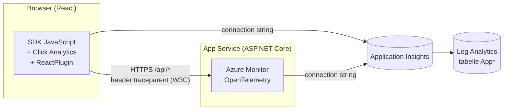

# Application Insights: dove si vede nel codice

Questa guida mappa ogni affermazione sull'approccio Application Insights a un
esempio concreto di questo repository. Per il setup completo vedere il
[README](README.md).

**Messaggio chiave:** raccolta e correlazione sono gestite dagli SDK con
protocolli standard (W3C Trace Context). Il codice applicativo aggiunge solo
nomi di eventi e proprietà di dominio. **Nessuna DCR, DCE, stream o tabella
`_CL`** è presente nel repository.

## 1. Schema end-to-end



## 2. Instrumentazione e storage (senza DCR)

| Cosa | Dove nel codice |
|---|---|
| Inizializzazione SDK JavaScript con la sola connection string | [telemetry.ts](src/store-web/src/telemetry.ts#L38-L96) |
| Backend con `UseAzureMonitor` (distro OpenTelemetry) | [Program.cs](src/Store.Api/Program.cs#L53-L57) |
| Application Insights collegato al workspace Log Analytics, nessuna DCR tra le risorse | [resources.bicep](infra/resources.bicep#L13-L34) |

```ts
// src/store-web/src/telemetry.ts
client = new ApplicationInsights({
  config: {
    connectionString: config.applicationInsightsConnectionString,
    extensions: [reactPlugin, clicks],
    // ...
  },
});
```

```csharp
// src/Store.Api/Program.cs
otel.UseAzureMonitor(options =>
{
    options.ConnectionString = connectionString;
});
```

I dati finiscono nelle tabelle native del workspace (`AppPageViews`,
`AppEvents`, `AppRequests`, `AppDependencies`, `AppExceptions`, `AppTraces`,
`AppMetrics`, `AppBrowserTimings`). Le query in
[azure-queries.kql](docs/azure-queries.kql) le interrogano direttamente.

## 3. Raccolta automatica degli eventi UI

| Evento | Come viene raccolto | Dove |
|---|---|---|
| Page view | `trackPage` dal router SPA | [telemetry.ts](src/store-web/src/telemetry.ts#L100-L103), [App.tsx](src/store-web/src/App.tsx#L132) |
| Click | Plugin Click Analytics con `autoCapture: true`, sugli elementi marcati `data-ai-*` | [telemetry.ts](src/store-web/src/telemetry.ts#L39-L50), [App.tsx](src/store-web/src/App.tsx#L12-L16) |
| Chiamate fetch/XHR, errori JS, performance | Automatici dell'SDK | [telemetry.ts](src/store-web/src/telemetry.ts#L52-L72) |

```tsx
// src/store-web/src/App.tsx: basta marcare l'elemento
const tag = (id: string) => ({
  'data-ai-id': id,
  'data-ai-contentname': id,
});

<button onClick={onRemove} {...tag(`cart.remove.${item.product.id}`)}>Rimuovi</button>
```

I click arrivano in `AppEvents` e si riconoscono da
`Properties.baseTypeSource == "ClickEvent"`
([query](docs/azure-queries.kql)).

## 4. Correlazione frontend → backend (standard, automatica)

| Passaggio | Dove nel codice |
|---|---|
| L'SDK browser invia l'header W3C `traceparent` | [telemetry.ts](src/store-web/src/telemetry.ts#L67) |
| La distro OpenTelemetry del backend legge lo stesso `traceparent`: richiesta e dipendenza condividono `OperationId` | [Program.cs](src/Store.Api/Program.cs#L53-L57) |
| Verifica del formato dell'header in un test end-to-end | [telemetry.spec.ts](src/store-web/e2e/telemetry.spec.ts#L126) |

```ts
// src/store-web/src/telemetry.ts
distributedTracingMode: DistributedTracingModes.W3C,
```

```kusto
// docs/azure-queries.kql: l'intera catena con un solo OperationId
let operation = "INCOLLA-OPERATION-ID";
union AppRequests, AppDependencies, AppExceptions, AppTraces, AppEvents
| where OperationId == operation
| project TimeGenerated, Type, AppRoleName, OperationId, ParentId, Properties
| order by TimeGenerated asc
```

> La correlazione tecnica **non richiede nessun campo applicativo**. Il
> `journeyId` del demo (più sotto) serve solo a raggruppare l'intero percorso
> dell'utente per l'analisi.

## 5. Eventi di business e proprietà applicative

Le proprietà di dominio finiscono in `Properties` (dynamic), senza modificare
alcuno schema. L'equivalente di `event_id`, `comune` e simili è `productId`,
`orderId`, `category`.

**Frontend**: `trackEvent(nome, proprietà)`

Implementazione reale: [funzione `trackEvent` in telemetry.ts](src/store-web/src/telemetry.ts#L105-L107).

```ts
// src/store-web/src/telemetry.ts
export function trackEvent(name: string, properties: Record<string, string | number | boolean> = {}) {
  client?.trackEvent({ name }, { ...properties, journeyId });
}
```

Utilizzi reali in `App.tsx`:

- [`CartItemAdded` nell'aggiunta di un prodotto al carrello](src/store-web/src/App.tsx#L150-L155):
  invia `productId`, `quantity` e `unitPrice`.
- [`CheckoutCompleted` dopo la creazione dell'ordine via API](src/store-web/src/App.tsx#L164-L171):
  invia `orderId` e `total` restituiti dal backend.

```tsx
// src/store-web/src/App.tsx
trackEvent('CartItemAdded', { productId: product.id, quantity: 1, unitPrice: product.price });
trackEvent('CheckoutCompleted', { orderId: result.id, total: result.total });
```

**Backend**: evento custom tramite log con `microsoft.custom_event.name`

Utilizzo reale: [emissione di `OrderPlaced` in Program.cs](src/Store.Api/Program.cs#L143-L154),
nell'endpoint `POST /api/orders`, dopo il salvataggio dell'ordine.

```csharp
// src/Store.Api/Program.cs
logger.LogInformation("{microsoft.custom_event.name} {orderId} {journeyId} {total}",
    "OrderPlaced", order.Id, order.JourneyId, order.Total);
```

Risultato in `AppEvents`: riga con `Name == "OrderPlaced"` e `Properties`
contenente `orderId`, `journeyId` e `total`.

**Un identificativo di business condiviso (opzionale).** Il demo propaga un
`journeyId` anonimo: l'SDK browser lo aggiunge a tutta la telemetria e il
backend lo riceve nell'header `X-Demo-Journey`.

| Passaggio | Dove nel codice |
|---|---|
| Aggiunto a ogni elemento di telemetria del browser | [telemetry.ts](src/store-web/src/telemetry.ts#L93-L94) |
| Inviato con ogni chiamata API | [api.ts](src/store-web/src/api.ts#L26) |
| Letto dal backend e impostato come tag/scope | [Program.cs](src/Store.Api/Program.cs#L76-L87) |

## 6. Cosa NON è presente (e non serve)

- Nessuna Data Collection Rule, Data Collection Endpoint o stream `Custom-*_CL`.
- Nessun ruolo *Monitoring Metrics Publisher* su una DCR.
- Nessun codice di correlazione scritto a mano: header W3C gestiti dagli SDK.
- Nessuno schema da mantenere in Log Analytics: i campi custom viaggiano in
  `Properties`.

## 7. Limiti del demo rispetto a un contesto con rete privata

Il demo usa una connection string Application Insights letta dal browser a runtime.
Configurazioni con private endpoint o solo Entra ID richiedono passaggi
aggiuntivi non coperti qui; vedere la sezione *Da chiarire insieme* della
mail.

## 8. Utente, sessione e username applicativo

**Nel demo**, l'SDK browser ha i [cookie abilitati](src/store-web/src/telemetry.ts#L33-L98):

| Campo in Log Analytics | Significato |
|---|---|
| `UserId` | ID anonimo nel cookie `ai_user`: identifica il browser, non una persona autenticata |
| `SessionId` | ID nel cookie `ai_session`: cambia dopo 30 minuti di inattività o 24 ore di durata |
| `Properties.journeyId` | UUID applicativo in [sessionStorage](src/store-web/src/api.ts#L3-L16), condiviso con il backend; distinto dalla sessione SDK |

**Per uno username autenticato** (login non presente nel demo), aggiungere
queste chiamate in [telemetry.ts](src/store-web/src/telemetry.ts), con SDK inizializzato:

```ts
// Dopo un login verificato, prima degli eventi da attribuire:
client?.setAuthenticatedUserContext('utente-demo-42', undefined, false);
// Al logout o prima di cambiare account:
client?.clearAuthenticatedUserContext();
```

Lo username valorizza `UserAuthenticatedId` sugli eventi successivi.
`undefined` omette l'account/organizzazione; `false` evita il cookie e richiede
di reimpostare l'identità dopo ogni reload. Con `true` si usa `ai_authUser`,
che non sostituisce l'autenticazione.
Usare un identificativo non vuoto, senza spazi o `, ; = |`; preferire un ID
pseudonimizzato e valutare privacy, consenso/base giuridica e retention.

**Backend:** l'identità non viene trasferita automaticamente dal browser.
Ricavarla dalle claim validate lato server e aggiungerla ai log, per esempio
come `Properties.username`, senza fidarsi di header username del client.
Una proprietà custom non popola automaticamente `UserAuthenticatedId`.

Ricerca degli eventi frontend in Log Analytics:

```kusto
AppEvents
| where UserAuthenticatedId == "utente-demo-42"
| project TimeGenerated, Name, UserId, SessionId, Properties
| order by TimeGenerated asc
```

Riferimenti: [API JavaScript](https://microsoft.github.io/ApplicationInsights-JS/API-reference)
e [durata delle sessioni](https://learn.microsoft.com/en-us/azure/azure-monitor/app/javascript-sdk-configuration#identifiers-and-session-lifetime).
